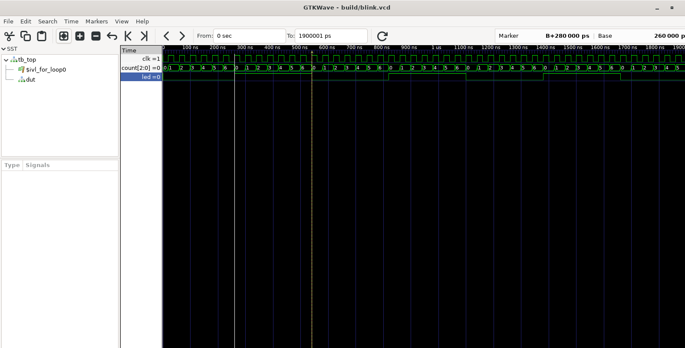

# uwrl-ecp5-fpga-onboarding

WRL FPGA onboarding: an LED blinker in SystemVerilog, simulated with Icarus Verilog, checked in GTKWave, and synthesized for ECP5 with Yosys. Target board is the ULX3S (25 MHz clock), but everything here runs in simulation only.

```
rtl/top.sv             the design
sim/tb_top.sv          testbench
sim/blink.gtkw         GTKWave save file (clk, counter in decimal, led)
scripts/sim.sh         compile + run the testbench, optional HALF_PERIOD_CYCLES override
scripts/break_test.sh  runs the testbench on an off-by-one copy of the design
scripts/synth.sh       yosys synth_ecp5 + check + stat
scripts/find_cell.py   dumps cells of one type from build/top.json with their nets
evidence/              saved sim/synth output and the waveform screenshot
build/                 generated, ignored
```

## Tool versions

- OSS CAD Suite 2026-09-16 (Linux x64), in Ubuntu 26.04 on WSL2
- Icarus Verilog 14.0 (devel) (s20260301-451-gc9ed76463)
- Yosys 0.69+62 (git sha1 0edda7a3a)
- GTKWave v4.0.0-prealpha (132a086)
- git 2.53.0, Python 3.14.4 (only for `find_cell.py`)

## Commands

Load the suite in each new shell first:

```bash
source "$HOME/oss-cad-suite/environment"
```

Simulate (default 7, then 6 and 1):

```bash
iverilog -g2012 -Wall -s tb_top -o build/tb_top rtl/top.sv sim/tb_top.sv
vvp build/tb_top

iverilog -g2012 -Wall -s tb_top -Ptb_top.HALF_PERIOD_CYCLES=6 -o build/tb_top rtl/top.sv sim/tb_top.sv
vvp build/tb_top

iverilog -g2012 -Wall -s tb_top -Ptb_top.HALF_PERIOD_CYCLES=1 -o build/tb_top rtl/top.sv sim/tb_top.sv
vvp build/tb_top
```

or `scripts/sim.sh`, `scripts/sim.sh 6`, `scripts/sim.sh 1`.

Off-by-one check: `scripts/break_test.sh early` and `scripts/break_test.sh late`

Waveform (default run):

```bash
scripts/sim.sh
gtkwave build/blink.vcd sim/blink.gtkw
```

Synthesis:

```bash
yosys -l build/synth.log -p 'read_verilog -sv rtl/top.sv; synth_ecp5 -top top -json build/top.json; check -assert; stat'
```

(`scripts/synth.sh` runs the same thing quietly.)

## Blink count and counter width

1 s full blink at 25 MHz with equal on/off time:

- full period = 25,000,000 cycles
- half period = 25,000,000 / 2 = **12,500,000 cycles** -> default `HALF_PERIOD_CYCLES`
- check: 12,500,000 x 40 ns = 0.5 s on, 0.5 s off

The counter goes 0 to 12,499,999 and then wraps when the LED flips, so it needs to hold 12,500,000 different values:

- 2^23 = 8,388,608 (too small)
- 2^24 = 16,777,216 (enough)
- so **24 bits**, which is `$clog2(12_500_000)`

In the RTL the width is `$clog2(HALF_PERIOD_CYCLES)`, with a minimum of 1 bit since `$clog2(1) = 0` would give a zero-width counter for N = 1. For N = 7 and N = 6 it's 3 bits.

## Design

`top` counts rising edges of `clk_25mhz`. When the counter is at `HALF_PERIOD_CYCLES - 1` it goes back to 0 and `led` flips, otherwise it increments. So the Nth edge since the last flip is the one that flips it, i.e. flips happen on edges N, 2N, 3N, ... Both the counter and the LED register are initialised to 0 in their declarations (the ECP5 flow supports this), so `led` starts low.

## Simulation

The testbench works out the expected LED value from the edge number alone: after rising edge n the LED should be `floor(n / N) mod 2`. It doesn't copy the design's counter logic, so a counting bug in `top` can't hide itself in the testbench.

What it checks:

1. `led` is 0 at 1 ps (after time-zero init, before the first edge at 20 ns)
2. 1 ps after every rising edge, `led === expected` (case equality so X/Z fail too)
3. a separate `always @(led)` block fails if `led` changes at any time that isn't a rising edge (glitches between edges), goes X/Z, or flips on an edge that isn't a multiple of N
4. total number of flips is 6
5. a timeout in its own `initial` block
6. `PASS` and `$finish` only after all of that

It runs 7 half-periods minus one edge, so an extra flip anywhere before where the 7th would be also gets caught.

Passing runs (full output in [evidence/sim_pass.txt](evidence/sim_pass.txt)):

```
HALF_PERIOD_CYCLES = 7, expecting led flips on edges 7, 14, 21, ... (48 edges total)
PASS: HALF_PERIOD_CYCLES = 7, 48 edges checked, 6 toggles

HALF_PERIOD_CYCLES = 6, expecting led flips on edges 6, 12, 18, ... (41 edges total)
PASS: HALF_PERIOD_CYCLES = 6, 41 edges checked, 6 toggles

HALF_PERIOD_CYCLES = 1, expecting led flips on edges 1, 2, 3, ... (6 edges total)
PASS: HALF_PERIOD_CYCLES = 1, 6 edges checked, 6 toggles
```

### Breaking it on purpose

`scripts/break_test.sh` copies `rtl/top.sv` into `build/`, changes the wrap value, and runs the same testbench on the copy (the real RTL isn't touched). Output in [evidence/sim_broken.txt](evidence/sim_broken.txt).

One cycle early (`CNT_MAX = N - 2`):

```
FATAL: sim/tb_top.sv:60: led toggled on edge 6 at   220.000 ns, should only toggle on multiples of 7
```

One cycle late (`CNT_MAX = N`):

```
FATAL: sim/tb_top.sv:87: edge 7 (  260.001 ns): led = 0, expected 1
```

Both fail on the first wrong edge. Reran 7, 6 and 1 on the real design afterwards and they all pass.

## Waveform



Default run, N = 7. Signals are `tb_top.clk`, `tb_top.dut.count` (unsigned decimal) and `tb_top.led`.

- clock: 40 ns period, first rising edge at 20 ns, so edge k is at 20 + 40(k - 1) ns
- `count` goes 0..6 and wraps to 0 on the same edge that `led` flips
- first flip is on edge 7 at 260 ns (20 + 6 x 40)
- baseline marker B is on that edge (260 ns), primary marker on the next flip at 540 ns: the header shows **B+280 000 ps = 280 ns** between transitions = 7 x 40 ns
- a full on/off cycle is 2 x 280 = **560 ns** (260 -> 540 -> 820 ns, then 1100, 1380, 1660 in the screenshot)

## Synthesis

Full summary in [evidence/synth.txt](evidence/synth.txt). Synthesized with the real default (12,500,000).

```
Found and reported 0 problems.

       50 cells
       12   CCU2C
       11   LUT4
        2   PFUMX
       25   TRELLIS_FF
```

- `check -assert` passes, 0 problems
- no latches inferred (the only "latch" lines in the log are pass names like `PROC_DLATCH`, nothing gets created)
- the only warnings: `write_xaiger2` is experimental (used internally by synth_ecp5's abc9 step), and ABC saying "the network is combinational", which is expected since the flip-flops are kept out of what ABC maps

25 flip-flops = 24 counter bits + 1 for `led`, which matches the width calculation.

### What the cells are doing

**TRELLIS_FF (state).** One bit of storage clocked by `clk_25mhz`. This is the LED register from `build/top.json` ([evidence/cells.txt](evidence/cells.txt)):

```
TRELLIS_FF  led_q_TRELLIS_FF_Q
    param CEMUX = CE
    param REGSET = RESET
    input  CE    -> led_q_TRELLIS_FF_Q_CE
    input  CLK   -> clk_25mhz
    input  DI    -> led_q_LUT4_D_Z
    input  LSR   -> const 0
    output Q     -> led
```

`Q` drives the `led` port. `DI` comes from a LUT4 whose only input is `led` with `INIT = 0x00FF`, which is just NOT, so the next value is always `~led`. The clock enable `CE` is the "counter is at max" signal, so the FF only loads `~led` on the wrap edge and holds otherwise. That's exactly `if (count == CNT_MAX) led_q <= ~led_q;`. `REGSET = RESET` gives the 0 initial value.

The counter bit FFs use the same "counter is at max" net, but on `LSR` (synchronous set/reset, `SRMODE = LSR_OVER_CE`) instead of CE, so they go to 0 on that edge, which is the `count <= '0` branch.

**CCU2C (counting).** The ECP5 carry cell: two bits of an adder with a fast carry chain between cells. 12 of them chained make up the `count + 1` incrementer. One of them:

```
CCU2C  count_TRELLIS_FF_Q_12_DI_CCU2C_S1
    input  B0    -> count[14]
    input  B1    -> count[15]
    input  CIN   -> count_TRELLIS_FF_Q_8_DI_CCU2C_S0_COUT
    output COUT  -> count_TRELLIS_FF_Q_12_DI_CCU2C_S1_COUT
    output S0    -> count_TRELLIS_FF_Q_12_DI_CCU2C_S1_S0
    output S1    -> count_TRELLIS_FF_Q_12_DI
```

It takes counter bits 14 and 15 on `B0`/`B1` and the carry from the cell below on `CIN`, puts the incremented bits out on `S0`/`S1` (these go straight to the `DI` of the count[14] and count[15] flip-flops), and passes its carry up through `COUT`.

**LUT4 / PFUMX.** The LUT4s are the rest of the logic, mostly the 24-bit compare against 12,499,999. A LUT4 only has 4 inputs so the compare gets split across several, and the 2 PFUMX cells mux LUT outputs together to finish the wide compare that becomes the "counter at max" net.

Synthesis doesn't check routed timing, that would be nextpnr.
